# Teach-Once

**Teach a web task once. Run it on every row of a spreadsheet with zero model calls. When the site changes, it heals itself.**

Browser agents that ask a model what to do on every click are slow, expensive and unreliable at volume. Measured on the same task, a computer-use agent needed 27 model calls, $0.30 and almost 7 minutes per row, and finished 7 rows out of 10. Teach-Once runs the same row in about a second with no model calls. It only calls a model when the site has changed, and the fix it finds is reused by every row after it.

1. **Teach**: do the task once in your browser while saying what you're doing.
2. **Compile**: Meta's models turn the recording into a deterministic, parameterized workflow.
3. **Run**: the workflow runs over a CSV file with no model calls at all.
4. **Heal**: when a redesign breaks a step, Muse Spark works out what changed and SAM 3.1 finds the element on the new screen. The workflow is patched, verified and saved as a new version, and every later row runs with zero model calls again.

Built for the Meta Global AI Developer Hackathon (indie track). The main target is **Demoland TransitPass Portal**, a fictional government-style e-service included in this repo (it is not a real service), because healing needs a site that can be redesigned on demand. Teaching and running also work on real sites: see [On a real site](#on-a-real-site-orangehrm).

## How it works

```mermaid
flowchart LR
    T["Teach once<br/>clicks + tab video + narration"] --> V["Muse Voice Transcribe<br/>narration → timed turns"]
    V --> S["Muse Spark<br/>video + events → steps, variables"]
    S --> W["Muse Wonder<br/>→ workflow + Playwright script"]
    W --> R["Runner<br/>every CSV row, 0 model calls"]
    R -- "a step breaks" --> H["Muse Spark triage<br/>+ SAM 3.1 grounding"]
    H -- "patched, verified, vN+1" --> R
    H -- "blocked, or data the rows don't have" --> P["Stop and say why"]
```



| Meta model | What it does here |
|---|---|
| **Muse Voice Transcribe** | Turns the narration into timestamped turns. "This is the vehicle number from the sheet" is how a typed value becomes a variable. |
| **Muse Spark 1.3** | Watches the teach video next to the recorded event log and returns the steps, which values change per row, and a visual description of each control. When a step breaks, it looks at the new page and decides what changed: moved, different kind of control, split into parts, on the next page of the form, removed, a popup in the way, or "this needs a person". |
| **Muse Wonder 1.0** | Compiles the step graph and the recorded locators into a workflow under a strict JSON schema, and exports a standalone Playwright script. Called once per teach, never in a loop. |
| **SAM 3.1** | Segments the controls on the new screen ("dropdown menu", "blue button"). The detection under Spark's pick confirms where the element is, and its mask is drawn on the heal card. |

Spark decides *which* element is meant; SAM shows *exactly where* it is. Neither is asked to do the other's job: SAM finds controls by how they look, not by their labels.

## Results

All measured on the demo portal ([DOCS.md](DOCS.md) has the details).

| Per row | Teach-Once | Computer-use agent (Muse Spark) |
|---|---|---|
| Model calls | **0** | 27 |
| Cost | **$0** | $0.30 |
| Time | **1.1–1.5 s** | 6.8 min |
| Rows completed | **50/50** | 7/10 |
| At 10,000 rows a day | ~$0.30 once to compile, ~$0.05 per redesign, 3–4 h | ~$3,000 and ~1,140 hours |

Compiling a 60–100 s recording takes 40–150 s and $0.22–0.45.

| Redesign of the portal | Result |
|---|---|
| Renamed ids, moved and relabelled button | 50/50 rows, 1 heal, ~$0.01 |
| + reworded labels, date split into day/month/year, radios → dropdown | 50/50 rows, 1 page heal, ~$0.03 |
| + cookie modal and a session-notice page, switched on mid-run | 50/50 rows, 3 heals, ~$0.04 |
| Switched 0 → 3 → 0 → 2 → 1 → 0 → 3 during one run | 50/50 rows, 3 heals, $0.037 (switching back needs no heal) |
| **20 random redesigns** (two-page forms, custom dropdowns, removed fields, popups, reworded everything...) | **20/20 recovered**, 100/100 rows, $0.055 per redesign |
| A new mandatory field the rows have no data for; access blocked | **Stopped with the reason**, 2/2, one Spark call each |

### On a real site: OrangeHRM

The same pipeline on [OrangeHRM's public demo](https://opensource-demo.orangehrmlive.com) (a real open-source HR app with a shared demo instance), with `teach_live.py`: sign in, Recruitment → Add candidate, first and last name, vacancy (a custom dropdown), email and contact number (labels not linked to their inputs), consent (a styled checkbox), Save.

| | |
|---|---|
| Recording | 19 s, 13 actions, no narration (driven by a script in a headless sandbox) |
| Compile | 92 s, $0.21, first try (no repair), dry run on 3 rows |
| Run | 6/6 rows (5 from the CLI, 1 from the app), **0 model calls**, ~10 s per row (each row signs in on the shared demo) |

Healing is shown on the portal only: a real site can't be redesigned on demand. Fake candidates only, a handful of rows.

## Quick start

Requires [uv](https://docs.astral.sh/uv/), `ffmpeg`, and Chrome or Chromium (teaching uses tab capture).

```bash
cp .env.example .env        # add your META_API_KEY
uv sync
uv run playwright install chromium
uv run check_api.py         # one cheap call per Meta model (~$0.005)
uv run uvicorn app:app --port 8000
```

Open **http://localhost:8000/app/** in Chrome. Everything happens in the browser:

1. **Teach**: click *Teach a new task*, then *Start teaching*; share the tab and the microphone, do the task in the portal (demo login `operator` / `demo123`) while narrating, and click *Stop*.
2. **Compile**: on the recording page, click *Compile workflow* and watch Voice Transcribe, Spark and Wonder work.
3. **Run**: click *▶ Run 50 rows* (fake rows are generated for you).
4. **Redesign**: while it runs, press *Portal redesign* 1, 2, 3 or *🎲 Random* in the header. Watch the heal cards, the new version, and the cost meter against the agent. Try *+ required field* or *Block bots* to see it stop and say why.

`uv run reset.py` puts the demo back to the start: original site, no runs, workflows as they were taught. Recordings are kept.

**Teach on another site** (needs a display; narration uses the default microphone):

```bash
uv run teach_live.py https://opensource-demo.orangehrmlive.com/web/index.php/auth/login --csv examples/orangehrm-candidates.csv
```

A browser opens; do the task once (the demo login is shown on its page), then press Enter in the terminal. If you typed a password, put it in `.env` under the name it prints (`ORANGEHRMLIVE_PASSWORD`). The recording appears in the app; compile and run it there, on the rows of the CSV.

## Command line

| Command | |
|---|---|
| `uv run teach_live.py <url> [--csv rows.csv]` | Teach on any website. |
| `uv run teach.py <rec_id>` | Compile a recording (for portal recordings the portal must be running). |
| `uv run run.py <workflow> data/rows.csv [--no-heal]` | Run a workflow over the rows. |
| `uv run bench.py [--redesigns 20] [--rows 5]` | The healing benchmark on random redesigns (~$1). |
| `uv run baseline.py data/rows.csv` | The computer-use agent on the same task (~$3). |
| `uv run reset.py` | Reset the demo. |
| `uv run cost.py` | Spend by purpose; a budget guard stops all calls at `MAX_SPEND_USD`. |
| `uv run pytest` | Tests (offline; live API tests are marked `live`). |

## Repo tour

| | |
|---|---|
| `app.py` | The single FastAPI app: the portal under `/portal`, Teach-Once under `/app`, the run dashboard and its live event stream. |
| `portal.py`, `templates/portal/` | The fictional portal, its redesign levels and random redesigns. |
| `static/recorder.js`, `recording.py` | The teach studio and what it records. |
| `teach_live.py`, `static/live.js` | The recorder for any website. |
| `teach.py`, `understand.py`, `compiler.py` | Recording → Voice Transcribe → Muse Spark → Muse Wonder → lint → dry run → export. |
| `workflow.py`, `locate.py`, `run.py` | The workflow format and the interpreter that runs it. |
| `heal.py`, `sam.py` | Self-healing with Muse Spark and SAM 3.1. |
| `baseline.py`, `bench.py` | The computer-use comparison and the healing benchmark. |
| `meta_client.py`, `cost.py`, `prompts.py` | Meta Model API client (retries, record/replay cache), cost ledger, prompts. |
| `examples/` | Sample workflows (fake values only) and the measured baseline summary. |

## Limitations

- The portal is synthetic and the benchmark is one task on one site. It shows the kinds of change the healer handles, not a guarantee for every site.
- Teach-Once does not get around bot detection or CAPTCHAs. When a site blocks automation it stops and tells you; an AI agent would be blocked the same way, at a higher cost.
- Data the rows don't have can't be invented: a new mandatory field stops the run until you add a column or teach again.
- A popup learned by a heal is dismissed by its button's name; a very generic name ("Continue") could match another button.
- The studio needs a Chromium-based browser (tab capture) and only frames the portal; other sites are taught with `teach_live.py`, which needs a display and records one tab.
- On real sites, fields are found by role, label (also unlinked labels next to the field), placeholder or id. A field with none of these unique can't be located.

## License

MIT
